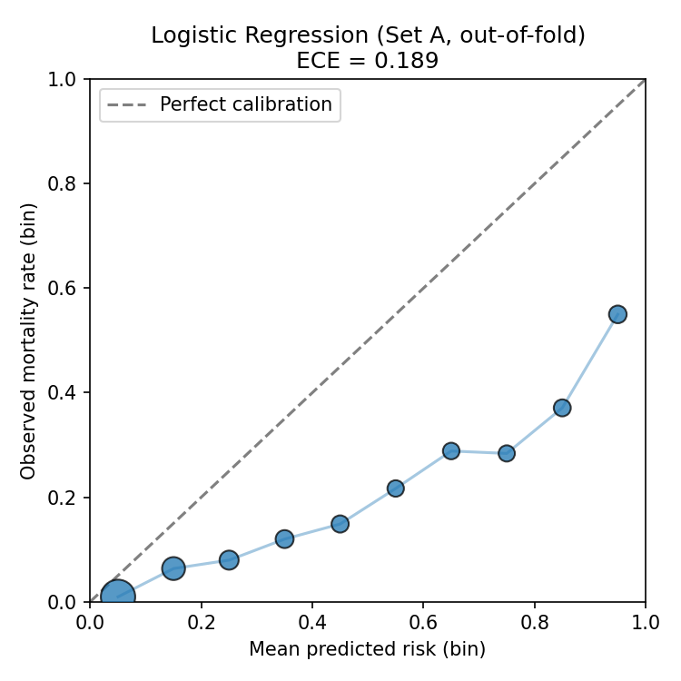

# icu-mortality-trustworthy-eval

Trustworthy risk prediction on real ICU patient data, evaluated the way a
model meant to inform clinical decisions should be: not just "how well
does it discriminate," but "is its risk score calibrated," "does it
generalize to a held-out cohort without re-tuning," "is it equally
calibrated across patient subgroups," and "what would using it actually
mean at the bedside."

```
per-stay ICU record (real, aggregated vitals/labs + demographics)
   |
   v
model: Logistic Regression  vs.  Gradient-Boosted Trees
   |
   v
in-hospital-mortality risk score
   |
   v
discrimination (AUROC/AUPRC) + calibration (ECE/Brier/reliability)
   + held-out generalization (Set A -> Set B, no re-tuning)
   + subgroup calibration (by ICU admission type)
   + clinical operating points (sensitivity/specificity/PPV at a threshold)
```

## Why this exists

A third portfolio piece in the same trustworthy-evaluation family as
`biomedical-rag-eval` and `sci-lit-rag-eval`, built specifically to close
a gap those two don't touch: neither uses real structured clinical
**patient** data, and neither has a held-out-cohort generalization check.
This one does both, on real ICU records rather than literature text.

## Data

Real PhysioNet/Computing in Cardiology Challenge 2012 records (12,000 ICU
stays; the 4,000-patient Set A and Set B, both with public outcomes, are
used here). See `data/PROVENANCE.md` for exactly how the data was
obtained in this sandbox (`physionet.org` itself is not reachable from
here; the same real data was retrieved via a public GitHub mirror
instead, and that substitution is documented rather than glossed over),
the required citations, and an empirically-checked (not assumed) data
leakage exclusion.

**Scope, stated plainly:** the data here is pre-aggregated to one row per
ICU stay (first/last/lowest/highest/median per variable), not a raw
per-timestamp sequence. This project is real-world clinical **tabular**
risk prediction, not sequence/time-series modeling -- see Limitations.

## Pipeline

1. **Models** (`src/models.py`): Logistic Regression (median-imputed,
   standardized, `class_weight="balanced"`) and `HistGradientBoostingClassifier`
   (handles missingness natively -- a real value that was never drawn stays
   informative rather than being imputed away), plus a **SAPS-I-alone**
   baseline (the raw clinical severity score, no fitting at all -- what
   the original 2012 challenge asked entrants to beat).
2. **Cross-validation** (`train.py`): 5-fold stratified CV on Set A,
   producing genuinely out-of-fold predictions for every patient (no
   model is ever evaluated on rows it trained on).
3. **Trustworthy evaluation** (`src/evaluate_trust.py`, `evaluate.py`):
   AUROC/AUPRC, Expected Calibration Error, Brier score, reliability
   diagrams, subgroup calibration by ICU admission type
   (CCU/CSRU/SICU/MICU), and clinically-framed operating points
   (sensitivity/specificity/PPV/flagged-rate at a few thresholds).
4. **Held-out generalization check**: both models are fit once on *all*
   of Set A and evaluated *once* on Set B -- no re-tuning, no threshold
   selection on B -- the same "does it hold up outside the data it was
   built on" question a real deployment has to answer.

## Running it

```bash
pip install -r requirements.txt
python train.py --seed 42        # 5-fold CV on Set A, writes results/oof_predictions.json
python evaluate.py               # adds SAPS-I baseline + Set B held-out check, writes results/report.md
python scripts/check_leakage.py          # verifies the Survival/Length_of_stay exclusion empirically
python scripts/class_weight_ablation.py  # verifies the class-balancing/calibration diagnostic below
```

## Results

*(from `results/report.md`, regenerated by `evaluate.py`; seed 42, 5-fold CV)*

| Model | AUROC | AUPRC | ECE | Brier |
|---|---|---|---|---|
| Logistic Regression (Set A, out-of-fold) | 0.840 ± 0.015 | 0.460 ± 0.035 | 0.189 ± 0.015 | 0.157 ± 0.013 |
| Gradient-Boosted Trees (Set A, out-of-fold) | 0.858 ± 0.010 | 0.515 ± 0.021 | 0.070 ± 0.007 | 0.097 ± 0.004 |
| SAPS-I score alone, no fitting (Set A) | 0.638 | 0.222 | n/a | n/a |

Both real models clearly beat the SAPS-I clinical-severity-score baseline
on discrimination. The AUROC gap between the two models is small and,
under a paired per-fold t-test (5 folds), **not statistically significant**
(p = 0.109) -- reported as such rather than as a clean win for the
stronger model.

**Reliability diagrams (Set A, out-of-fold):**

| Logistic Regression | Gradient-Boosted Trees |
|---|---|
|  |  |

**Held-out generalization (fit on Set A only, evaluated once on Set B):**

| Model | AUROC | AUPRC | ECE | Brier |
|---|---|---|---|---|
| Logistic Regression | 0.841 | 0.502 | 0.198 | 0.160 |
| Gradient-Boosted Trees | 0.849 | 0.504 | 0.062 | 0.099 |
| SAPS-I score alone | 0.660 | 0.253 | n/a | n/a |

Both models' Set A and Set B numbers are close on every metric -- a real,
if modest, generalization check passed, not assumed.

### Reading the results honestly

- **Calibration, not discrimination, is where the two models really
  differ.** GBT's ECE (0.070) is roughly a third of Logistic Regression's
  (0.189) for essentially the same AUROC. Diagnosed rather than left as a
  bare number: re-running Logistic Regression *without*
  `class_weight="balanced"` drops its ECE to **0.033** (better than GBT)
  with **identical AUROC to three decimal places** (see `results/report.md`
  for the full diagnostic and `scripts/class_weight_ablation.py`).
  Class-balancing bought nothing here and cost calibration -- the
  headline table above keeps the balanced run rather than quietly
  swapping in the better one, because that trade-off is the actual
  finding.
- **This is the opposite pattern from `biomedical-rag-eval`**, where the
  more powerful model (a real LLM) was *less* calibrated than the
  classical baseline. Here the more powerful model (GBT) is *better*
  calibrated. Calibration is not a fixed property of "how powerful the
  model is" -- it depends on the specific modeling choices (here, a class
  -weighting decision that has nothing to do with model capacity).
- **Calibration is not uniform across ICU admission type.** In the
  subgroup breakdown (`results/report.md`), MICU patients have the worst
  calibration for both models (LogReg ECE 0.237, GBT ECE 0.086) against
  CSRU's best (0.094 / 0.038) -- a real, clinically-relevant form of
  miscalibration a single aggregate ECE number would hide entirely.
- **The clinical operating-point table makes the discrimination number
  concrete**: to catch ~80% of deaths on Set B, the model has to flag
  34.3% of all patients, at a positive predictive value of 33% -- i.e.
  two out of three flagged patients would not have died. This is not a
  flaw in the model so much as the actual, uncomfortable shape of the
  sensitivity/specificity trade-off at a 14% base rate, made explicit
  rather than hidden behind a single AUROC number.
- **Extreme missingness in a few labs (TroponinI/T, Cholesterol: 78-95%
  missing) is real clinical practice**, not a data quality problem: these
  labs are not drawn on every patient. `HistGradientBoostingClassifier`
  uses missingness itself as a signal rather than needing it imputed away.

## Limitations

- **Tabular, not sequence-based.** The data used here is pre-aggregated
  per stay; this project does not build or evaluate a model over raw
  irregular time series, and should not be described as one. A genuine
  extension would parse the raw per-timestamp PhysioNet 2012 records (or
  a comparable dataset) and evaluate a sequence model (e.g. a simple
  GRU-D-style RNN or a time-aware attention model) under the same
  trustworthy-evaluation harness (`src/evaluate_trust.py` is not specific
  to tabular inputs and would not need to change).
- **Set A and Set B are a random split of the same population**, not
  genuinely distinct hospitals or a different era of care, per the
  challenge's own design. The Set A -> Set B check here is an honest
  held-out-and-never-tuned-on generalization test, but it is **not**
  external/cross-hospital validation in the sense that term is usually
  used in the clinical-ML literature, and is not described as such above.
- **No hyperparameter tuning** was performed for either model (both use
  library defaults plus the documented `class_weight`/`sample_weight`
  choice); reported numbers are a fair from-defaults comparison, not a
  ceiling for either model.
- The 80%-sensitivity operating point was chosen by looking at Set B
  itself, so it illustrates a real trade-off rather than certifying a
  deployable threshold -- a deployable threshold would need to be fixed
  on training data alone and then only evaluated, once, on held-out data.
