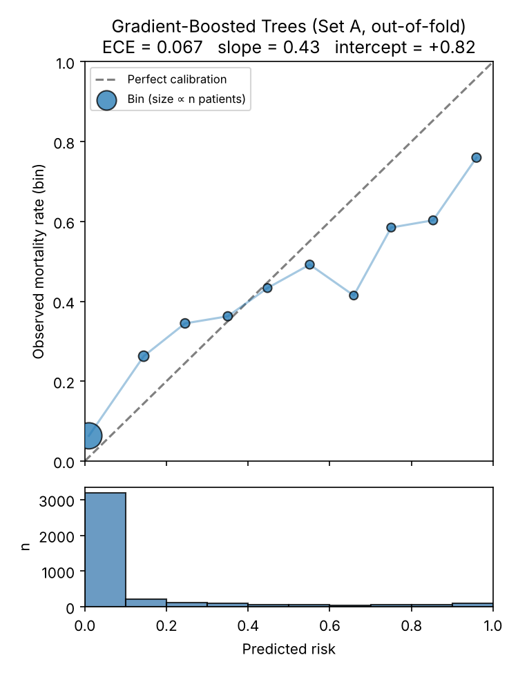

# icu-mortality-trustworthy-eval

Trustworthy risk prediction on real ICU patient data, evaluated the way a
model meant to inform clinical decisions should be: not just "how well
does it discriminate," but "is its risk score calibrated," "does it
generalize to a held-out cohort without re-tuning," "is it equally
calibrated across patient subgroups," "how uncertain are these numbers,"
and "what would using it actually mean at the bedside."

```
per-stay ICU record (real, aggregated vitals/labs + demographics)
   |
   v
model: Logistic Regression  vs.  Gradient-Boosted Trees  (vs. SAPS-I, no fitting)
   |
   v
in-hospital-mortality risk score
   |
   v
discrimination (AUROC/AUPRC) + calibration (ECE, Brier, intercept/slope, reliability)
   + held-out generalization (Set A -> Set B, no re-tuning) with bootstrap CIs
   + subgroup calibration (by ICU admission type, on both cohorts)
   + clinical operating points (threshold fixed on Set A, applied once to Set B)
   + diagnostics: class-weight ablation, seed robustness, leakage check
```

## Why this exists

A third portfolio piece in the same trustworthy-evaluation family as
`biomedical-rag-eval` and `sci-lit-rag-eval`, built specifically to close
a gap those two don't touch: neither uses real structured clinical
**patient** data, and neither has a held-out-cohort generalization check.
This one does both, on real ICU records rather than literature text.

## Data

Real PhysioNet/Computing in Cardiology Challenge 2012 records (12,000 ICU
stays; the 4,000-patient Set A and Set B, both with public outcomes, are
used here). See `data/PROVENANCE.md` for exactly how the data was
obtained in this sandbox (`physionet.org` itself is not reachable from
here; the same real data was retrieved via a public GitHub mirror
instead, and that substitution is documented rather than glossed over),
the required citations, and an empirically-checked (not assumed) data
leakage exclusion.

**Scope, stated plainly:** the data here is pre-aggregated to one row per
ICU stay (first/last/lowest/highest/median per variable), not a raw
per-timestamp sequence. This project is real-world clinical **tabular**
risk prediction, not sequence/time-series modeling -- see Limitations.

## Pipeline

1. **Models** (`src/models.py`): Logistic Regression (median-imputed with
   missing-indicators, standardized, `class_weight="balanced"`) and
   `HistGradientBoostingClassifier` (handles missingness natively -- a
   value that was never drawn stays informative rather than being imputed
   away; balanced `sample_weight`), plus a **SAPS-I-alone** baseline (the
   raw clinical severity score, no fitting at all -- what the original
   2012 challenge asked entrants to beat).
2. **Cross-validation** (`train.py`): 5-fold stratified CV on Set A,
   producing genuinely out-of-fold predictions for every patient (no
   model is ever evaluated on rows it trained on).
3. **Trustworthy evaluation** (`src/evaluate_trust.py`, `evaluate.py`):
   AUROC/AUPRC; Expected Calibration Error with both equal-width and
   equal-mass bins; Brier score; calibration intercept and slope (the
   two numbers TRIPOD-style reporting asks for); reliability diagrams
   with a risk histogram; subgroup calibration by ICU admission type
   (CCU/CSRU/SICU/MICU); label-stratified bootstrap confidence intervals;
   and clinically-framed operating points.
4. **Held-out generalization check**: both models are fit once on *all*
   of Set A and evaluated *once* on Set B -- no re-tuning, no threshold
   selection on B -- with a paired bootstrap for the GBT-vs-LogReg
   difference on the same patients.
5. **Diagnostics** (`scripts/`): a class-weighting ablation for both
   models, a multi-seed re-run of the cross-validation, and the leakage
   check that justifies the excluded columns.

## Running it

```bash
pip install -r requirements.txt
python train.py --seed 42                # 5-fold CV on Set A -> results/oof_predictions.json
python scripts/check_leakage.py          # Survival/Length_of_stay exclusion -> results/leakage_check.json
python scripts/class_weight_ablation.py  # class-balancing vs calibration, both models
python scripts/seed_robustness.py        # same CV under 6 seeds (~4 min)
python evaluate.py                       # SAPS-I baseline, Set B held-out check, CIs -> results/report.md
python -m pytest -q                      # unit tests for the metric code
```

`evaluate.py` picks up the three diagnostic outputs if they exist, so run
the scripts before it (the order above). Total runtime is a few minutes
on a laptop CPU.

## Results

*(from `results/report.md`, regenerated by `evaluate.py`; seed 42, 5-fold
CV, scikit-learn 1.9.1 -- see Reproducibility)*

**Cross-validated, out-of-fold, Set A** (per-fold mean ± std; calibration
intercept/slope on pooled OOF predictions, ideal 0 and 1):

| Model | AUROC | AUPRC | ECE | Brier | Cal. intercept | Cal. slope |
|---|---|---|---|---|---|---|
| Logistic Regression | 0.840 ± 0.015 | 0.460 ± 0.035 | 0.189 ± 0.015 | 0.157 ± 0.013 | −1.90 | 0.63 |
| Gradient-Boosted Trees | 0.852 ± 0.006 | 0.523 ± 0.022 | 0.074 ± 0.008 | 0.097 ± 0.003 | +0.82 | 0.43 |
| SAPS-I score alone, no fitting | 0.638 | 0.222 | n/a | n/a | n/a | n/a |

Both real models clearly beat the SAPS-I clinical-severity-score baseline
on discrimination. The AUROC gap between the two models is small: the
paired per-fold t-test gives p = 0.19 for this seed, but that number is
**not stable** -- across six seeds it ranges from 0.004 to 0.19 while the
gap itself stays between +0.007 and +0.016 (see "Seed robustness" in the
report). The better-powered comparison is the paired bootstrap on Set B
below.

**Reliability diagrams (Set A, out-of-fold):**

| Logistic Regression | Gradient-Boosted Trees |
|---|---|
|  |  |

**Held-out generalization (fit on Set A only, evaluated once on Set B;
95% bootstrap CI, 1000 label-stratified resamples):**

| Model | AUROC | AUPRC | ECE | Brier | Cal. intercept | Cal. slope |
|---|---|---|---|---|---|---|
| Logistic Regression | 0.841 [0.824, 0.857] | 0.502 [0.469, 0.543] | 0.198 [0.189, 0.206] | 0.160 [0.152, 0.168] | −1.96 | 0.67 |
| Gradient-Boosted Trees | 0.850 [0.833, 0.866] | 0.518 [0.480, 0.558] | 0.058 [0.051, 0.068] | 0.096 [0.091, 0.102] | +0.44 | 0.47 |
| SAPS-I score alone | 0.660 [0.635, 0.683] | 0.253 [0.230, 0.282] | n/a | n/a | n/a | n/a |

Paired bootstrap on the same Set B patients, GBT − LogReg:

| Metric | Difference [95% CI] | Two-sided bootstrap p |
|---|---|---|
| AUROC | +0.009 [−0.003, +0.021] | 0.15 |
| AUPRC | +0.016 [−0.022, +0.045] | 0.40 |
| Brier | −0.064 [−0.071, −0.057] | < 0.001 |
| ECE | −0.139 [−0.151, −0.127] | < 0.001 |

Both models' Set A and Set B numbers are close on every metric -- a real,
if modest, generalization check passed, not assumed. The discrimination
difference between the models is **not** distinguishable from zero even
with 4,000 held-out patients; the calibration difference unambiguously
is.

### Reading the results honestly

- **Calibration, not discrimination, is where the two models really
  differ**, and the two models fail in *opposite directions*. The
  class-balanced Logistic Regression systematically over-predicts risk
  (mean predicted 0.33 against an observed 0.14; intercept −1.9). The
  GBT is roughly right on average but its predictions are too extreme
  (slope 0.43–0.47 against an ideal of 1): the reliability diagrams show
  its high-risk bins sitting well below the diagonal. A single ECE number
  would call GBT "three times better calibrated" and hide that second
  pattern entirely.
- **The Logistic Regression miscalibration is entirely
  `class_weight="balanced"`.** Re-running without it drops ECE from
  0.189 to **0.033** (better than GBT) and the intercept to −0.01, with
  **identical AUROC**. For the GBT the same ablation goes the *other*
  way: unweighted GBT under-predicts (mean 0.07), and balanced weighting
  pulls it part-way back, improving ECE from 0.084 to 0.067. So "class
  balancing hurts calibration" is not a general law; it depends on what
  the unweighted model was doing in the first place. The headline table
  keeps the balanced runs rather than quietly swapping in the better
  one, because that trade-off is the actual finding. Full table in
  `results/report.md`.
- **This is the opposite pattern from `biomedical-rag-eval`**, where the
  more powerful model (a real LLM) was *less* calibrated than the
  classical baseline. Calibration is not a fixed property of "how
  powerful the model is" -- it depends on specific modeling choices
  (here a weighting decision and a regularization decision, neither of
  which has anything to do with model capacity).
- **Calibration is not uniform across ICU admission type.** MICU patients
  have the worst calibration for both models on both cohorts (Set B:
  LogReg ECE 0.239, GBT 0.095) against CSRU's best (0.094 / 0.025) -- a
  real, clinically-relevant form of miscalibration a single aggregate
  ECE number would hide. The pattern replicates on the held-out cohort,
  so it is not a fold artifact.
- **A pre-specified threshold does not deliver what it promised.** The
  GBT threshold that gives 80% sensitivity on Set A (chosen out-of-fold,
  before touching Set B) actually gives **85.6% sensitivity on Set B at
  the cost of flagging 42% of all patients, with a PPV of 29%** -- i.e.
  more than two out of three flagged patients would not have died. The
  prevalence threshold (0.139) is more stable: 59% sensitivity on A,
  64% on B. This is not a flaw in the model so much as the actual,
  uncomfortable shape of the trade-off at a 14% base rate, and the
  reason thresholds must be evaluated once on held-out data rather than
  reported from the data they were picked on.
- **Extreme missingness in a few labs (TroponinI/T, Cholesterol: 78–95%
  missing) is real clinical practice**, not a data quality problem: these
  labs are not drawn on every patient. `HistGradientBoostingClassifier`
  uses missingness itself as a signal rather than needing it imputed away;
  the Logistic Regression gets explicit missing-indicator columns.

## Reproducibility

- Logistic Regression results reproduce to 4 decimal places across
  scikit-learn versions. **GBT results do not**: the same code and seed
  gave a CV AUROC of 0.858 (p = 0.109) under the unpinned scikit-learn
  version this repo was first built with and 0.852 (p = 0.190) under
  1.9.1, with individual patient predictions differing by up to 0.6.
  Within one version the GBT is fully deterministic (identical output
  across re-runs and thread counts). `requirements.txt` is therefore
  pinned, `results/summary.json` records the versions that produced it,
  and the seed-robustness sweep exists precisely so that no single
  p-value is presented as the comparison.
- `results/` is committed so the tables above can be checked against
  the generating code without re-running it.

## Limitations

- **Tabular, not sequence-based.** The data used here is pre-aggregated
  per stay; this project does not build or evaluate a model over raw
  irregular time series, and should not be described as one. A genuine
  extension would parse the raw per-timestamp PhysioNet 2012 records (or
  a comparable dataset) and evaluate a sequence model (e.g. a simple
  GRU-D-style RNN or a time-aware attention model) under the same
  trustworthy-evaluation harness (`src/evaluate_trust.py` is not specific
  to tabular inputs and would not need to change).
- **Set A and Set B are a random split of the same population**, not
  genuinely distinct hospitals or a different era of care, per the
  challenge's own design. The Set A -> Set B check here is an honest
  held-out-and-never-tuned-on generalization test, but it is **not**
  external/cross-hospital validation in the sense that term is usually
  used in the clinical-ML literature, and is not described as such above.
- **No hyperparameter search** was performed for either model. Both use
  library defaults except two settings fixed up front and listed in
  `src/models.py` (`max_iter=2000` for the solver; `max_iter=200`
  boosting rounds for the GBT, twice the default, with no early stopping)
  plus the documented class-weighting choice. The GBT's calibration
  slope of ~0.45 says those 200 unregularized rounds over-fit; early
  stopping or post-hoc recalibration on a held-out fold is the obvious
  next step and was deliberately *not* done here, so that the reported
  numbers remain a from-defaults comparison rather than a tuned one.
- **The bootstrap CIs are for the Set B evaluation only.** They quantify
  sampling uncertainty in the held-out estimate for the fitted models;
  they do not account for variability from refitting the models
  themselves (the seed sweep partly covers that for the CV estimates).
- The leakage check was wrong in its first version (a linear test that
  understated the leakage badly); the correction is documented rather
  than silently overwritten in `data/PROVENANCE.md`.
