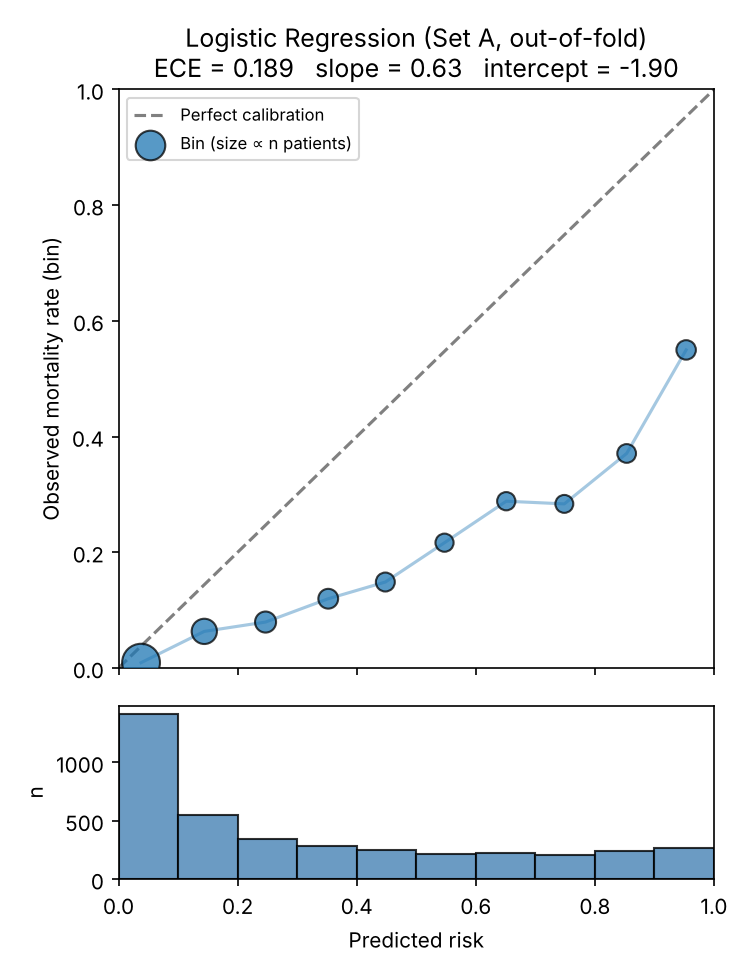
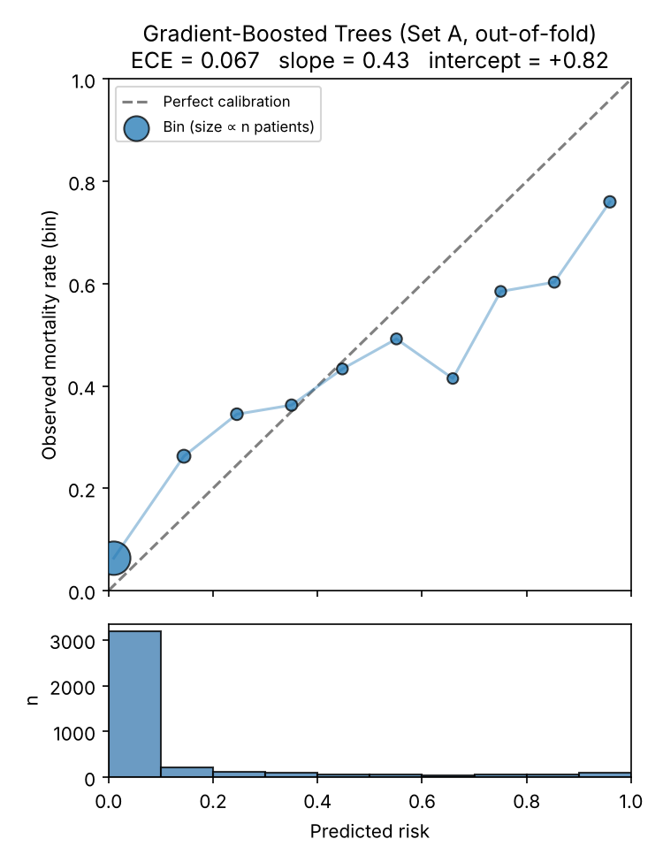
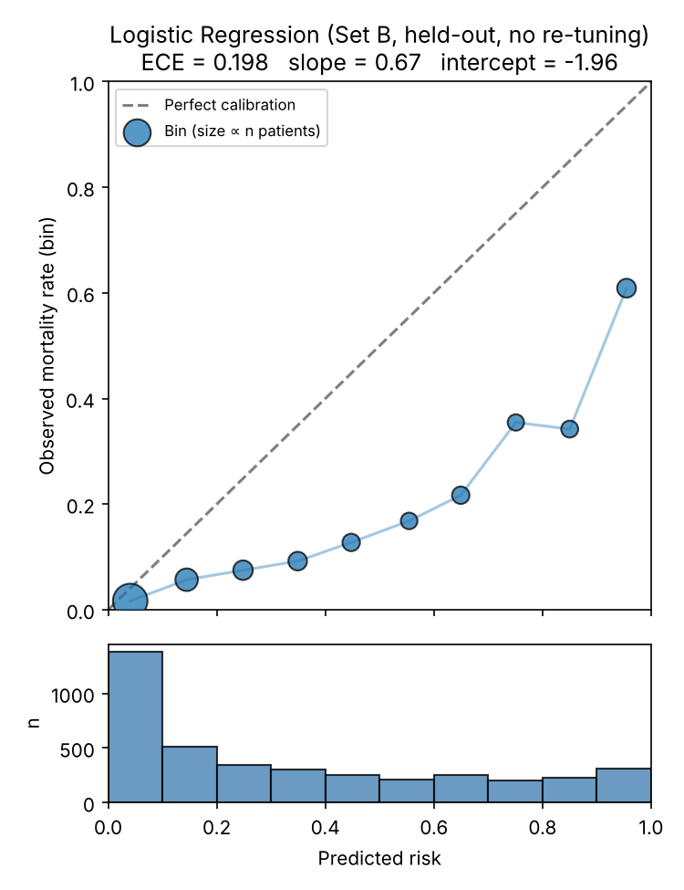
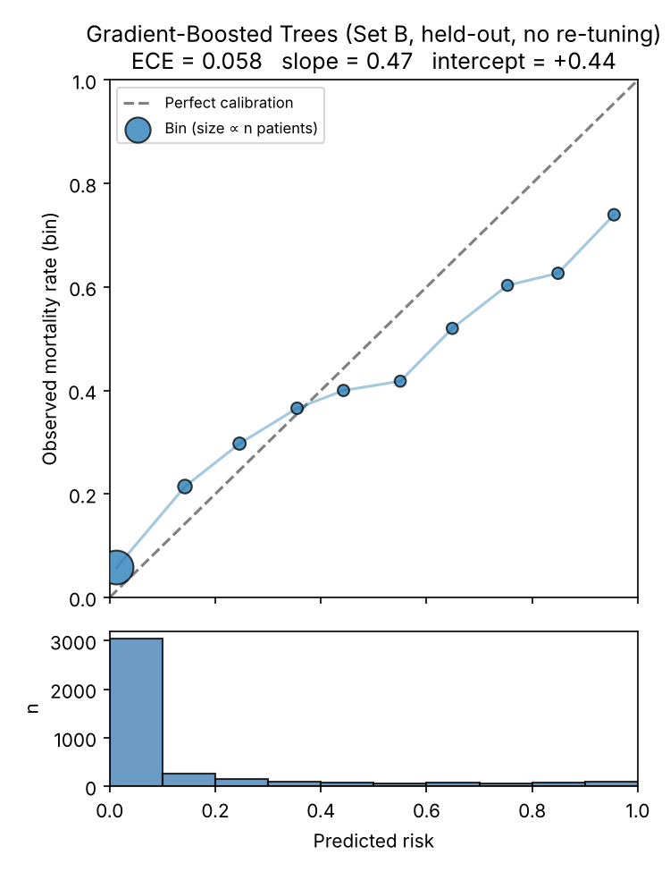

# Results summary

Seed 42, 5-fold stratified CV on Set A (n=4000, 116 features), held-out check on Set B (n=4000, fit only on Set A, never re-tuned). Bootstrap CIs: 1000 label-stratified resamples. Environment: Python 3.13.18, scikit-learn 1.9.1 (GBT results are reproducible within a scikit-learn version but shift slightly across versions -- see the reproducibility note in README).

## Cross-validated (out-of-fold) performance, Set A

Per-fold mean ± std across folds; calibration intercept/slope on the pooled out-of-fold predictions (ideal: intercept 0, slope 1).

| Model | AUROC | AUPRC | ECE | Brier | Cal. intercept | Cal. slope |
|---|---|---|---|---|---|---|
| Logistic Regression | 0.840 ± 0.015 | 0.460 ± 0.035 | 0.189 ± 0.015 | 0.157 ± 0.013 | -1.90 | 0.63 |
| Gradient-Boosted Trees | 0.852 ± 0.006 | 0.523 ± 0.022 | 0.074 ± 0.008 | 0.097 ± 0.003 | +0.82 | 0.43 |
| SAPS-I score alone (no fitting) | 0.638 | 0.222 | n/a | n/a | n/a | n/a |

Paired per-fold AUROC difference (GBT − LogReg): mean +0.0114, paired t-test p=0.1904 (5 folds only -- indicative, not a strong-power test; see the Set B paired bootstrap and the seed-robustness section below).

Pooled out-of-fold ECE with equal-width vs equal-mass (quantile) bins -- the two disagree when predictions are concentrated near zero, as they are for most patients at 14% prevalence:

| Model | ECE (10 equal-width bins) | ECE (10 equal-mass bins) | Mean predicted | Observed rate |
|---|---|---|---|---|
| Logistic Regression | 0.189 | 0.189 | 0.328 | 0.139 |
| Gradient-Boosted Trees | 0.067 | 0.068 | 0.101 | 0.139 |

## Held-out generalization: fit on Set A, evaluate once on Set B

Point estimate [95% bootstrap CI].

| Model | AUROC | AUPRC | ECE | Brier | Cal. intercept | Cal. slope |
|---|---|---|---|---|---|---|
| Logistic Regression | 0.841 [0.824, 0.857] | 0.502 [0.469, 0.543] | 0.198 [0.189, 0.206] | 0.160 [0.152, 0.168] | -1.96 | 0.67 |
| Gradient-Boosted Trees | 0.850 [0.833, 0.866] | 0.518 [0.480, 0.558] | 0.058 [0.051, 0.068] | 0.096 [0.091, 0.102] | +0.44 | 0.47 |
| SAPS-I score alone (no fitting) | 0.660 [0.635, 0.683] | 0.253 [0.230, 0.282] | n/a | n/a | n/a | n/a |

Paired bootstrap, GBT − LogReg on the same Set B patients (n=4000; far better powered than the 5-fold t-test above):

| Metric | Difference (GBT − LogReg) [95% CI] | Two-sided bootstrap p |
|---|---|---|
| AUROC | +0.0090 [-0.0032, +0.0209] | 0.148 |
| AUPRC | +0.0158 [-0.0222, +0.0451] | 0.400 |
| BRIER | -0.0639 [-0.0710, -0.0572] | 0.000 |
| ECE | -0.1394 [-0.1512, -0.1269] | 0.000 |

**Reliability diagrams (Set A, out-of-fold):**

| Logistic Regression | Gradient-Boosted Trees |
|---|---|
|  |  |

**Reliability diagrams (Set B, held-out, no re-tuning):**

| Logistic Regression | Gradient-Boosted Trees |
|---|---|
|  |  |

## Subgroup calibration by ICU admission type

ECE here uses 8 equal-width bins (groups are smaller than the full cohort), so it is comparable across rows of these tables but not to the 10-bin aggregate ECE above.

**Set A, out-of-fold:**

| ICU type | n | Mortality rate | LogReg ECE | LogReg slope | LogReg AUROC | GBT ECE | GBT slope | GBT AUROC |
|---|---|---|---|---|---|---|---|---|
| CCU | 577 | 0.140 | 0.195 | 0.72 | 0.836 | 0.063 | 0.48 | 0.864 |
| CSRU | 874 | 0.049 | 0.094 | 0.70 | 0.885 | 0.035 | 0.46 | 0.907 |
| MICU | 1481 | 0.186 | 0.237 | 0.54 | 0.798 | 0.089 | 0.40 | 0.812 |
| SICU | 1068 | 0.145 | 0.198 | 0.67 | 0.835 | 0.081 | 0.40 | 0.837 |

**Set B, held-out (fit on Set A only):**

| ICU type | n | Mortality rate | LogReg ECE | LogReg slope | LogReg AUROC | GBT ECE | GBT slope | GBT AUROC |
|---|---|---|---|---|---|---|---|---|
| CCU | 590 | 0.122 | 0.182 | 0.62 | 0.799 | 0.066 | 0.41 | 0.810 |
| CSRU | 782 | 0.043 | 0.094 | 0.66 | 0.858 | 0.025 | 0.48 | 0.856 |
| MICU | 1436 | 0.199 | 0.239 | 0.58 | 0.799 | 0.095 | 0.41 | 0.796 |
| SICU | 1192 | 0.148 | 0.223 | 0.79 | 0.854 | 0.045 | 0.59 | 0.882 |

## Clinically-framed operating points (GBT)

Mortality prevalence: Set A 0.139, Set B 0.142.

**Pre-specified thresholds** -- fixed on Set A out-of-fold predictions, then applied once to Set B. This is the deployable form of the question: the threshold is chosen before the held-out data is touched, and the Set B row shows what the chosen rule *actually* delivers out of sample.

| Rule (chosen on Set A) | Threshold | Data | Sensitivity | Specificity | PPV | NPV | Flagged rate |
|---|---|---|---|---|---|---|---|
| = Set A prevalence | 0.139 | Set A (OOF) | 0.590 | 0.890 | 0.463 | 0.931 | 0.176 |
| = Set A prevalence | 0.139 | Set B | 0.644 | 0.866 | 0.443 | 0.936 | 0.206 |
| 80% sensitivity on Set A (OOF) | 0.016 | Set A (OOF) | 0.801 | 0.725 | 0.319 | 0.958 | 0.347 |
| 80% sensitivity on Set A (OOF) | 0.016 | Set B | 0.856 | 0.650 | 0.288 | 0.965 | 0.421 |
| 90% sensitivity on Set A (OOF) | 0.004 | Set A (OOF) | 0.901 | 0.581 | 0.257 | 0.973 | 0.485 |
| 90% sensitivity on Set A (OOF) | 0.004 | Set B | 0.944 | 0.476 | 0.229 | 0.981 | 0.584 |

**Post-hoc thresholds on Set B** -- chosen by looking at Set B itself; they illustrate the trade-off curve but are not deployable numbers.

| Rule | Threshold | Sensitivity | Specificity | PPV | NPV | Flagged rate |
|---|---|---|---|---|---|---|
| = Set B prevalence | 0.142 | 0.641 | 0.869 | 0.448 | 0.936 | 0.203 |
| = 0.5 | 0.500 | 0.401 | 0.955 | 0.594 | 0.906 | 0.096 |
| 80% sensitivity chosen on Set B | 0.035 | 0.801 | 0.737 | 0.335 | 0.957 | 0.340 |

## Missingness (Set A, top 10 most-missing features)

| Feature | Missing fraction |
|---|---|
| TroponinI_last | 0.949 |
| TroponinI_first | 0.949 |
| Cholesterol_first | 0.924 |
| Cholesterol_last | 0.924 |
| TroponinT_last | 0.784 |
| TroponinT_first | 0.784 |
| RespRate_first | 0.725 |
| RespRate_median | 0.725 |
| RespRate_lowest | 0.725 |
| RespRate_highest | 0.725 |

## Diagnostic: why was Logistic Regression's calibration so much worse than GBT's?

Suspected `class_weight="balanced"` (used to get a reasonable decision boundary under 14% prevalence) as the cause, rather than assuming it, and re-ran both models with and without class balancing on the same folds (`scripts/class_weight_ablation.py`; pooled out-of-fold, Set A):

| Model | Variant | AUROC | ECE | Brier | Cal. intercept | Cal. slope | Mean predicted (observed 0.139) |
|---|---|---|---|---|---|---|---|
| Logistic Regression | class-balanced (used in headline run) | 0.841 | 0.189 | 0.157 | -1.90 | 0.63 | 0.328 |
| Logistic Regression | unweighted | 0.840 | 0.033 | 0.097 | -0.01 | 0.72 | 0.139 |
| Gradient-Boosted Trees | class-balanced (used in headline run) | 0.851 | 0.067 | 0.097 | +0.82 | 0.43 | 0.101 |
| Gradient-Boosted Trees | unweighted | 0.857 | 0.084 | 0.101 | +1.80 | 0.43 | 0.070 |

**Logistic Regression:** class-balancing was the whole story. AUROC is unchanged (0.841 vs 0.840) but ECE falls from 0.189 to 0.033 and the calibration intercept moves from -1.90 (systematic over-prediction: mean predicted risk 0.33 against an observed rate of 0.14) to -0.01 once the reweighting is removed. `class_weight="balanced"` reshapes predicted probabilities toward 50/50 to improve the decision boundary on imbalanced data and has no awareness of calibration at all. Class-balancing and probability calibration are two different objectives that can trade against each other.

**Gradient-Boosted Trees:** the same balanced reweighting (via `sample_weight`) behaves differently. The *unweighted* GBT under-predicts risk on average (mean predicted 0.070 against an observed rate of 0.139; intercept +1.80), and the balanced weighting pulls that part of the way back (mean predicted 0.101, intercept +0.82), so for this model class-balancing *improves* ECE (0.084 → 0.067) at a small cost in AUROC (0.857 → 0.851). Neither variant fixes the GBT's real calibration problem: a calibration slope of 0.43 (ideal 1.0) in both cases, i.e. predictions that are too extreme -- the signature of 200 boosting rounds with no early stopping on 3,200 training rows. That is a capacity/regularization issue, orthogonal to class weighting, and the natural next step would be early stopping or post-hoc recalibration on a held-out fold rather than a different weighting scheme.

The headline tables deliberately keep the class-balanced runs (the worse of the two on calibration for Logistic Regression, at identical discrimination) instead of quietly swapping in the better-calibrated unweighted version after the fact, because the miscalibration it causes is itself the more general finding here.

## Seed robustness of the cross-validated comparison

The 5-fold paired t-test above depends on one particular fold split. Re-running the identical cross-validation under several seeds (0, 1, 2, 3, 4, 42; pooled out-of-fold):

| Quantity | Mean | Std across seeds | Min | Max |
|---|---|---|---|---|
| LogReg AUROC | 0.8388 | 0.0026 | 0.8344 | 0.8415 |
| GBT AUROC | 0.8519 | 0.0026 | 0.8485 | 0.8549 |
| AUROC difference (GBT − LogReg) | 0.0131 | 0.0036 | 0.0070 | 0.0156 |
| LogReg ECE | 0.1888 | 0.0014 | 0.1871 | 0.1908 |
| GBT ECE | 0.0715 | 0.0028 | 0.0672 | 0.0744 |
| Per-fold paired t-test p (AUROC) | 0.1074 | 0.0692 | 0.0037 | 0.1904 |

The direction of the AUROC gap is stable across seeds, but the per-fold t-test p-value is not -- it is a function of which 5 folds happened to be drawn, which is the reason the Set B paired bootstrap is the comparison to quote.

## Leakage check (why `Survival` and `Length_of_stay` are excluded)

- The challenge's own definitions make the label a deterministic function of the two columns: `0 < Survival <= Length_of_stay` reproduces `In-hospital_death` on 100.0% of Set A rows.
- Depth-3 decision tree on `Survival` alone: AUROC 0.988 ± 0.002 (5-fold CV).
- Depth-3 decision tree on `Length_of_stay` alone: AUROC 0.572 ± 0.024 (5-fold CV).
- Depth-3 decision tree on both: AUROC 0.991 ± 0.001 (5-fold CV).
- A *linear* single-feature logistic regression on `Survival` gives AUROC 0.259: the relation is non-monotone (−1 for survivors, small positive for in-hospital deaths, large positive for later deaths), so a linear test understates the leakage badly. An earlier version of this project quoted that number as the evidence; it has been corrected.
